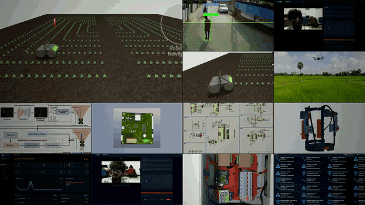
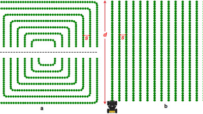
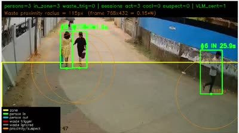
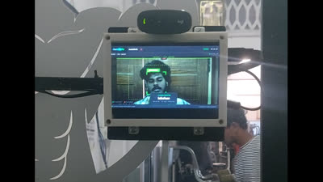
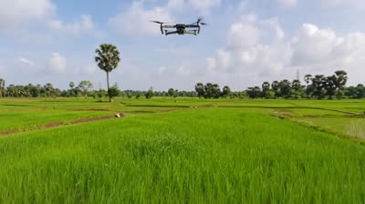
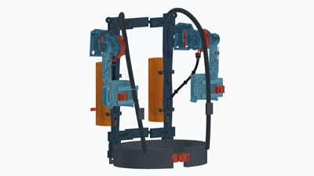
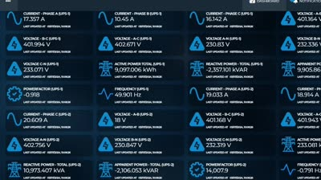

  

  
  
  

  

 

### 👨‍💻 About me

- 🌱 Researching **vision-based navigation for agricultural field robots**, including a new crop field layout (*Crop Spirals*) designed for future agri-robotics
- 👁️ Building **real-time computer vision** that runs at the edge: CCTV illegal-dumping detection, face-recognition access control
- 🔌 Designing **embedded hardware and firmware**: ESP32 / ESP-IDF, FreeRTOS, custom PCBs in KiCad
- 🎓 B.E.Tech (Hons) in Instrumentation & Automation, **University of Colombo**
- 🌐 Full case studies and research write-ups at **[lakshanlavan.github.io](https://lakshanlavan.github.io/)**

 

### 🚀 Featured work

<table>
  <tr>
    <td align="center" width="33%">
       
      <b>Crop Spirals</b> 
      Robot-centric spiral field layout for autonomous agricultural navigation. <i>Under review, Robotics and Autonomous Systems (Elsevier).</i>
    </td>
    <td align="center" width="33%">
       
      <b>CleanCity</b> 
      Edge-to-cloud CCTV vision that detects illegal waste dumping in real time, with tracking and VLM confirmation.
    </td>
    <td align="center" width="33%">
       
      <b><a href="https://github.com/lakshanlavan/facegate">FaceGate</a></b> 
      On-device access control at a gym door: recognition plus membership check driving an ESP32 relay.
    </td>
  </tr>
  <tr>
    <td align="center">
       
      <b>Agrarian v1.0</b> 
      Low-cost autonomous drone and RGB imaging for paddy crop-health monitoring.
    </td>
    <td align="center">
       
      <b>Passive Shoulder Exosuit</b> 
      Fully passive shoulder assistance for overhead work: no motors, no batteries, no control electronics.
    </td>
    <td align="center">
       
      <b>Server Room UPS Monitoring</b> 
      Embedded data acquisition for UPS power, temperature and humidity across a bank's data centre.
    </td>
  </tr>
</table>

<b>📂 Browse all public repositories</b>

 

| Repository | What it is | Stack |
| :-- | :-- | :-- |
| **🌾 Agricultural robotics** | | |
| [Field_LFNV](https://github.com/lakshanlavan/Field_LFNV) | Linear-field navigation for Clearpath Husky: crop prediction, reference-path planning, MPC tracking, row-manager FSM | Python&nbsp;·&nbsp;ROS&nbsp;2 |
| [Crop_WPNet](https://github.com/lakshanlavan/Crop_WPNet) | Multi-task ResNet-18 for crop-path waypoint regression and scene classification | Python&nbsp;·&nbsp;Deep&nbsp;learning |
| [husky-eyeview-lane-follow](https://github.com/lakshanlavan/husky-eyeview-lane-follow) | Bird's-eye (IPM) lane-centre follower for Clearpath Husky | Python&nbsp;·&nbsp;ROS&nbsp;2 |
| [uav-deposition-model-mismatch](https://github.com/lakshanlavan/uav-deposition-model-mismatch) | Deposition-aware reference shaping for UAV crop spraying, 200-scenario evaluation | MATLAB |
| **📐 Research studies** | | |
| [nominal-floor-robust-cvar-barrier-coverage](https://github.com/lakshanlavan/nominal-floor-robust-cvar-barrier-coverage) | NF-CVaR: robust sensor placement for stochastic barrier coverage | Python&nbsp;·&nbsp;LaTeX |
| [stochastic-barrier-coverage-code](https://github.com/lakshanlavan/stochastic-barrier-coverage-code) | Controlled synthetic study of sensor placement for stochastic barrier coverage | Python&nbsp;·&nbsp;MATLAB |
| [leakage-aware-urban-ai](https://github.com/lakshanlavan/leakage-aware-urban-ai) | Leakage-aware evaluation: bike-share demand forecasting and aerial building segmentation | Python&nbsp;·&nbsp;Jupyter |
| **🔌 Systems & embedded** | | |
| [facegate](https://github.com/lakshanlavan/facegate) | Face-recognition gym access control with admin panel and kiosk display | Python&nbsp;·&nbsp;FastAPI |
| [ADS1115_MultiChannel_Monitoring](https://github.com/lakshanlavan/ADS1115_MultiChannel_Monitoring) | Dual ADS1115 voltage monitoring with Modbus for custom boards | C++ |
| [SubMarineMotionController](https://github.com/lakshanlavan/SubMarineMotionController) | Submarine motion controller with LabVIEW visualisation | C++&nbsp;·&nbsp;LabVIEW |
| [WiFiBridge_V1](https://github.com/lakshanlavan/WiFiBridge_V1) | Battery-powered Wi-Fi bridge PCB built around the WT32-ETH01 | KiCad |
| [lakshanlavan.github.io](https://github.com/lakshanlavan/lakshanlavan.github.io) | Personal portfolio website | React&nbsp;·&nbsp;Vite |

 

### 🛠️ Tech stack

<table>
  <tr>
    <td><b>Languages</b></td>
    <td></td>
  </tr>
  <tr>
    <td><b>Robotics &amp; AI</b></td>
    <td>
       
      
      
      
      
      
      
    </td>
  </tr>
  <tr>
    <td><b>Embedded &amp; Hardware</b></td>
    <td>
       
      
      
      
      
    </td>
  </tr>
  <tr>
    <td><b>Apps &amp; Tools</b></td>
    <td></td>
  </tr>
</table>

 

### 📊 Languages across my GitHub

<picture>
  <source media="(prefers-color-scheme: dark)" srcset="https://raw.githubusercontent.com/lakshanlavan/lakshanlavan/output/languages-dark.svg" />
  
</picture>

  

<picture>
  <source media="(prefers-color-scheme: dark)" srcset="https://raw.githubusercontent.com/lakshanlavan/lakshanlavan/output/github-snake-dark.svg" />
  
</picture>

  

**📫 Let's connect:** [Portfolio](https://lakshanlavan.github.io/) · [LinkedIn](https://www.linkedin.com/in/lakshan29) · [lakshanlavan29@gmail.com](mailto:lakshanlavan29@gmail.com)

© 2026 Lakshan L. All rights reserved.

